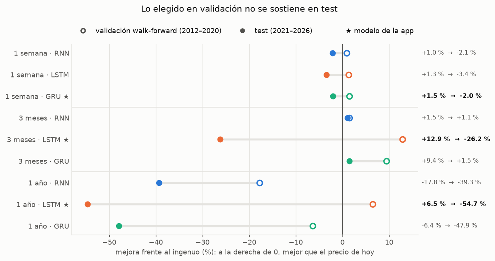
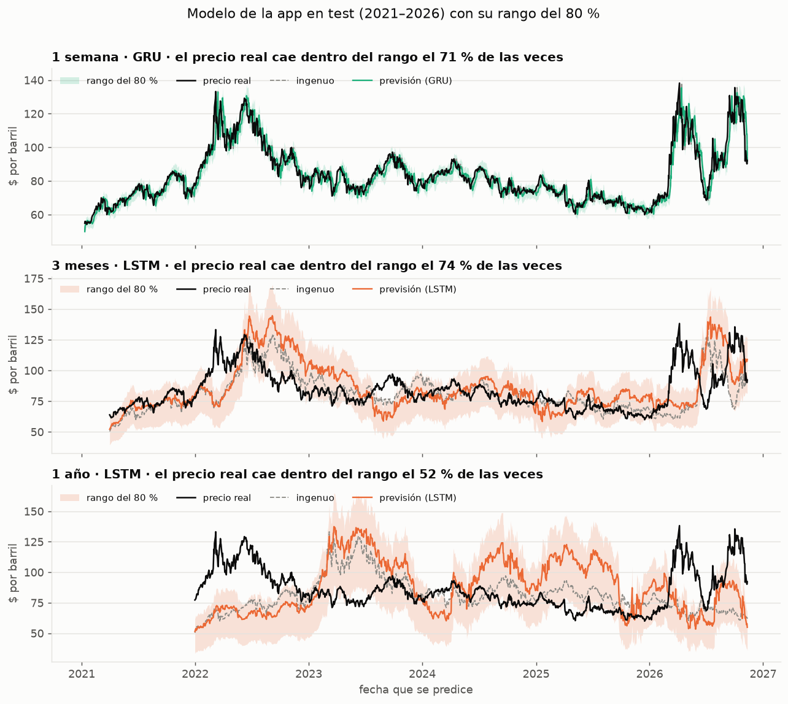
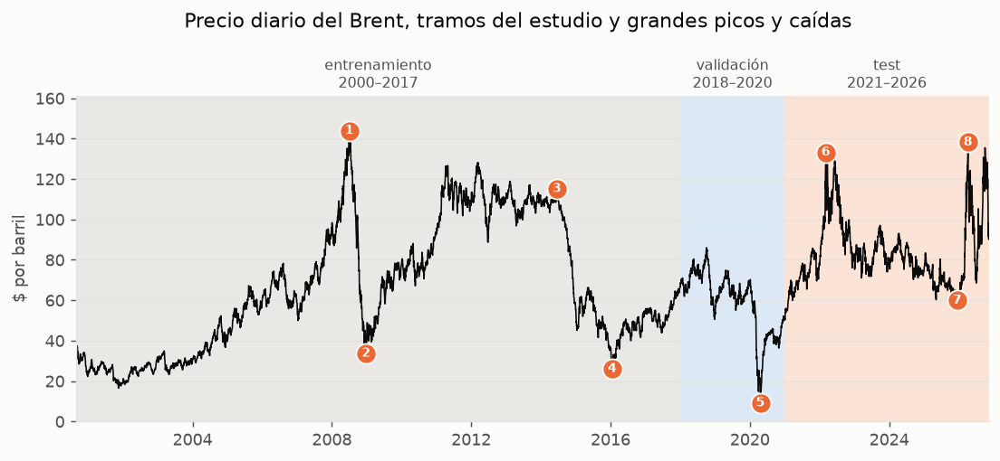
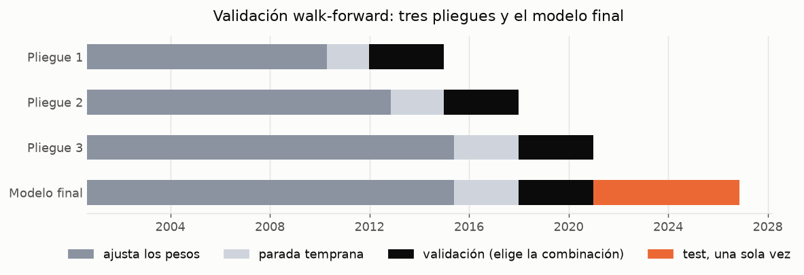

# Previsión del precio del Brent con RNN, LSTM y GRU

Caso de uso III de Aprendizaje automático. Tres redes recurrentes (RNN simple, LSTM y GRU)
predicen el Brent a **1 semana (5 días hábiles), 3 meses (63) y 1 año (252)**. Se comparan
entre sí y con el modelo ingenuo ("el precio futuro = el de hoy"). El modelo elegido de cada
horizonte se integra en una app web que da la previsión, su rango del 80 % y una explicación
en lenguaje sencillo.

- **App:** <https://prevision-brent.vercel.app> (ver [Despliegue](#despliegue))
- **Modelos:** <https://huggingface.co/judithsalas/oil_price_prediction_case02>. No están en este
  repositorio: la app los descarga de ahí la primera vez.
- **Todas las decisiones, con su justificación:** [`docs/decisiones.md`](docs/decisiones.md)

## Resultado en una tabla

Mejora del error frente al ingenuo (en positivo, mejor que el precio de hoy). La validación
es walk-forward 2012–2020 y el test es 2021–2026, evaluado una sola vez.

| Horizonte | Modelo de la app (elegido en validación) | Validación | Test | R² en test (red / ingenuo) | Rango del 80 %: aciertos en test |
|---|---|---|---|---|---|
| 1 semana | GRU | +1,5 % | −2,0 % | 0,88 / 0,88 | 71 % |
| 3 meses | LSTM | +12,9 % | −26 % | −0,60 / −0,19 | 74 % |
| 1 año | LSTM | +6,5 % | −55 % | −2,93 / −1,46 | 52 % |

**Ninguna red bate al ingenuo en test**, igual que en los repositorios de referencia. Lo que
la app aporta es el rango de incertidumbre y saber cuánto fiarse en cada horizonte. El R² de
0,88 a 1 semana es igual al del ingenuo: mide que el precio cambia poco en una semana, no que
la red acierte. La tabla completa (R², MAE, MSE, RMSE, parámetros y tiempo de las tres redes)
está en
[`docs/resultados/comparativa.csv`](docs/resultados/comparativa.csv) y en la propia app.





Cómo se repartieron los datos y cómo se validó:





## Instalación

Python 3.12 y [Poetry](https://python-poetry.org):

```bash
poetry install
```

## Cómo reproducirlo, paso a paso

Los resultados ya están en el repositorio y los modelos finales en
[Hugging Face](https://huggingface.co/judithsalas/oil_price_prediction_case02): para usar la app basta
con el paso 6, que descarga los modelos la primera vez. Los pasos 1 a 5 rehacen el estudio
desde cero. Para repetir solo la evaluación (pasos 4 y 5) con los modelos publicados, se
bajan antes con `poetry run python -m scripts.descargar_modelos`.

| Paso | Comando | Qué hace | Tiempo |
|---|---|---|---|
| 1 | `poetry run python -m scripts.download_data` | Descarga FRED (EIA, BCE, Fed, Cboe) y Yahoo Finance desde 2000 en `data/petroleo_dataset.csv` | 1 min |
| 2 | `poetry run python scripts/entrenar.py --semilla 0` (y luego `1` y `2`) | Rejilla de hiperparámetros en los 3 pliegues walk-forward, una semilla por ejecución | ~35 min cada una |
| 3 | `poetry run python scripts/entrenar.py --final` | Elige cada red por validación y la reentrena con 3 semillas en `models/final/` | ~4 min |
| 4 | `poetry run python scripts/evaluar.py` | Evaluación en test, **una sola vez**: Diebold-Mariano, Ridge y acierto de dirección | 1 min |
| 5 | `poetry run python scripts/comparar.py` | Tabla comparativa, modelo de la app e intervalos del 80 % con su cobertura en test | segundos |
| 5b | `poetry run python -m scripts.figuras` | Las 4 figuras de resumen (historia, walk-forward, validación frente a test y modelo de la app en test) | segundos |
| 6 | `poetry run uvicorn app.servidor:app --port 7860` | La app en <http://localhost:7860> (ver [La app](#la-app)) | — |

Tiempos medidos en un portátil con CPU. Los parámetros comunes (ventana de 60 días, fechas
de corte, rejilla, semillas) están en [`configs/experimento.yaml`](configs/experimento.yaml).

Pruebas:

```bash
poetry run python -m unittest
```

## La app

- Elegir horizonte y ver el rango en el que suele caer el precio (con las veces que acertó en
  test), la previsión central con su variación sobre el último precio y la fecha de ese precio.
- Un texto para no técnicos: qué dice la previsión, cuánto fiarse (según el test) y qué puede invalidarla.
- El histórico desde 2000 con los picos y caídas del ciclo económico explicados.
- **¿Acierta?**: el modelo de cada plazo en test (2021–2026) frente al precio real, con su rango
  del 80 %, y año a año su error frente al precio de hoy y las veces que el precio cayó dentro
  del rango.
- La comparativa de las tres redes, con el esquema de la validación walk-forward y lo que
  anticipaba la validación frente a lo que pasó en test.

Funciona de dos formas con la misma página ([`app/static/`](app/static)):

- **Publicada en Vercel (estática):** la página lee `datos.json`, que GitHub Actions
  ([`.github/workflows/web.yml`](.github/workflows/web.yml)) regenera cada día laborable con
  datos nuevos. El día 1 de cada mes, además, reentrena los modelos elegidos con todos los
  datos hasta ese día. Cada push a `main` también publica la web, con el código nuevo. Y se
  puede lanzar a mano desde la pestaña *Actions* de GitHub (*Web y modelos* → *Run workflow*,
  con o sin "reentrenar").
- **En local (con servidor):** `poetry run uvicorn app.servidor:app --port 7860`. Al
  arrancar descarga de Hugging Face los modelos que falten en `models/final/`. Añade
  botones para **descargar datos nuevos** y **reentrenar** desde la propia página. Guarda las
  descargas en `data/app_dataset.csv`, sin tocar el dataset del estudio, y los modelos
  reentrenados en `models/app/`.

La lógica es la misma en los dos casos ([`app/prevision.py`](app/prevision.py)):
[`app/servidor.py`](app/servidor.py) la expone con FastAPI y
[`scripts/exportar_web.py`](scripts/exportar_web.py) la vuelca en `web/`.

## Despliegue

La web va a Vercel y los modelos están en Hugging Face. El workflow
([`.github/workflows/web.yml`](.github/workflows/web.yml)) publica la web y sube los modelos
reentrenados; solo necesita dos secretos en GitHub (*Settings* → *Secrets and variables* →
*Actions*). Una sola vez:

1. Crear un token en <https://vercel.com/account/tokens>, con el equipo propio como ámbito,
   y guardarlo como secreto `VERCEL_TOKEN`.
2. Crear un token de **escritura** en <https://huggingface.co/settings/tokens> y guardarlo
   como secreto `HF_TOKEN`.
3. Si se quieren otros nombres (o se renombra el repositorio de modelos en Hugging Face),
   cambiar `PROYECTO_VERCEL` y `MODELOS_HF` en el workflow y
   `URL` en [`scripts/descargar_modelos.py`](scripts/descargar_modelos.py), y publicar
   antes los modelos del estudio en ese repositorio (ver abajo).
4. Lanzarlo a mano la primera vez (*Actions* → *Web y modelos* → *Run workflow*).

La primera ejecución crea el proyecto en Vercel. La dirección pública de la web aparece en
el proyecto de Vercel, en *Domains*.

- **Vercel** recibe solo la web estática ya generada (`web/`). No hay que importar el
  repositorio desde Vercel: el servidor FastAPI no se despliega allí.
- **Hugging Face** guarda los modelos, que no están en git. El workflow sube su ficha
  ([`models/README.md`](models/README.md)) y los reentrenados cada mes (`app/`), que
  recupera de allí en cada ejecución. Los 9 del estudio (`final/`) se publican a mano, solo
  si se rehace el estudio (pasos 1 a 3), con `pip install huggingface_hub`, `hf auth login` y:

  ```bash
  hf upload judithsalas/oil_price_prediction_case02 models/final final
  ```

Para generar la web en local sin subirla: `poetry run python -m scripts.exportar_web` (la deja
en `web/`).

## Estructura

```
petroleo/         código del estudio
  datos.py          descarga y limpieza (FRED + Yahoo)
  preproceso.py     outliers, entradas, partición temporal, escalado y ventanas
  modelos.py        RNN / LSTM / GRU con la misma arquitectura
  entrenamiento.py  entrenamiento con parada temprana, L2, dropout y recorte de gradiente
  evaluacion.py     Diebold-Mariano, Ridge y acierto de dirección
  graficas.py       curvas de aprendizaje, rejilla y test
scripts/          los pasos 1 a 5, la descarga de modelos y la exportación de la web estática
app/              la app web (lógica, servidor y página)
.github/workflows/ publica la web en Vercel y los modelos en Hugging Face (en cada push y a diario)
configs/          parámetros del experimento
models/           README.md: la ficha de los modelos en Hugging Face. Los modelos no están en git:
                  final/ (3 redes × 3 horizontes, 3 semillas cada uno) se descarga o se entrena
docs/
  decisiones.md     por qué se hizo cada cosa, experimentos, resultados y limitaciones
  resultados/       CSV de rejilla, entrenamiento, test y comparativa (v1–v3 en subcarpetas)
  figuras/          curvas, rejilla, mejora por semilla y test
tests/            pruebas unitarias
```

## Fuentes de datos

FRED: Brent (`DCOILBRENTEU`, variable objetivo) y WTI de la EIA, gas Henry Hub, tipo de
depósito del BCE, dólar/euro, yuan/dólar y VIX. Yahoo Finance: futuros del WTI (`CL=F`),
cobre, oro e índice del dólar. Los futuros del Brent (`BZ=F`) se descargan pero no entran en
el modelo porque empiezan en 2007, y la cesta de la OPEP no se usa porque no tiene fuente
diaria gratuita (ver `docs/decisiones.md`).

Herramienta educativa. No es asesoramiento financiero.
